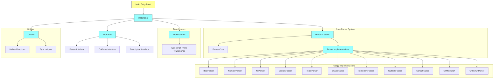

# Codebase Architecture

## Overview

This is a TypeScript validation and pattern matching library that provides a fluent API for defining and using parsers to validate data structures.

## Module Structure

## Key Components

### Main Entry Point (`matches.ts`)

The primary export that provides access to all parser functionality and the main API.

### Parser Classes

- **Core Parser System**: The foundation classes that define how parsers work
- **Parser Implementations**: Specific implementations for different data types (boolean, number, null/undefined, literals, etc.)
- **Composite Parsers**: Complex parsers built from simpler ones (tuples, shapes, dictionaries, concatenations)

### Transformers

- **TypeScript Types Transformer**: Converts parser definitions into TypeScript type strings

### Interfaces

- **IParser Interface**: Defines the contract for all parsers
- **OnParse Interface**: Handles parsing results and errors
- **Description Interface**: Provides metadata about parser structure

### Utilities

- **Helper Functions**: Utility functions that support parser operations
- **Type Helpers**: TypeScript utility types for better type safety

## Data Flow

1. User imports the main module (`matches.ts`)
2. User creates parser instances using factory methods or constructors
3. Parser instances are used to validate data through the `parse` method
4. Parsing results are handled through the `OnParse` interface callbacks
5. Parsers can be composed to create complex validation rules
6. Transformers can convert parser definitions into TypeScript types

## Key Features

- **Type Safety**: Full TypeScript support with proper typing throughout
- **Composability**: Parsers can be combined to create complex validation logic
- **Extensible**: Easy to add new parser types through the interface system
- **Transformers**: Convert parsers into TypeScript type definitions for documentation and development

This architecture enables developers to define complex data validation rules using a fluent, readable API while maintaining full TypeScript support and extensibility.
